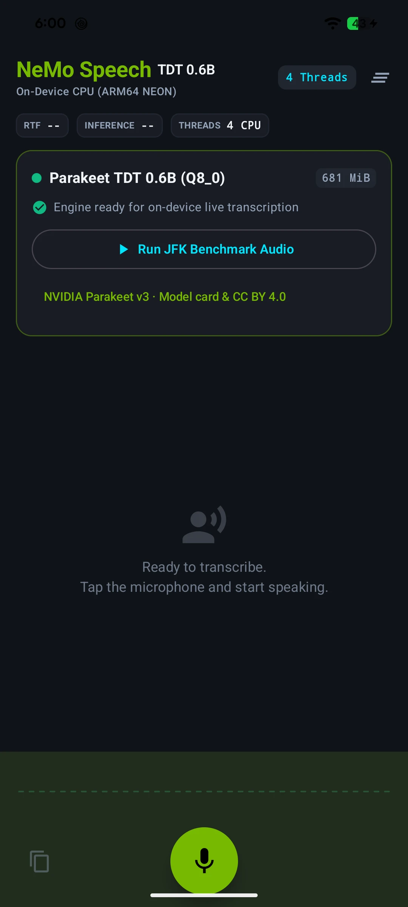
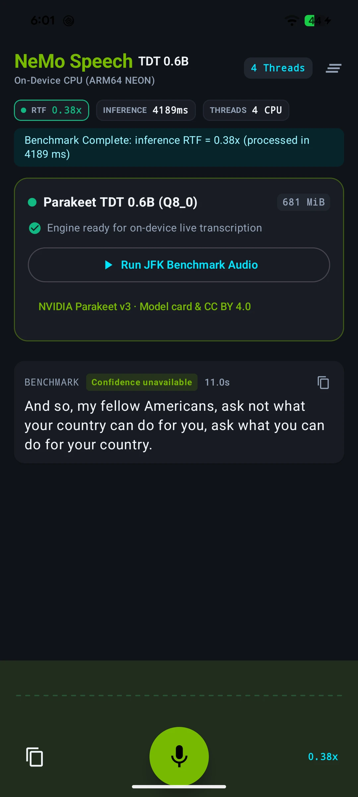

# Offline speech-to-text for Android: Parakeet + NeMo-Speech.cpp

On-device speech recognition for Android in Kotlin and Jetpack Compose. It runs NVIDIA's **Parakeet TDT 0.6B v3** (Q8_0 GGUF) on the phone's CPU through [NeMo-Speech.cpp](https://github.com/NVIDIA/NeMo-Speech.cpp) and ggml. No cloud API, no audio upload, and it works in airplane mode once the model is downloaded.

📖 **Full write-up with benchmarks:** [On-Device Speech-to-Text on Android: Parakeet and NeMo Benchmarks](https://meetprajapati.com/blogs/on-device-transcription-android-parakeet-nemo-speech/)

<p align="center">
  
  &nbsp;&nbsp;
  
</p>

## Results on a Pixel 8a

11-second clip, CPU only, 4 threads, 10 runs per build ([raw data](docs/benchmarks/)):

| CPU build (`-PcpuArch=`) | Median | Real-time factor |
| --- | --- | --- |
| `armv8-a` (default, portable) | 6,490 ms | 0.59 |
| `armv8.2-a+dotprod+fp16` | 4,134 ms | 0.38 |
| `armv8.2-a+dotprod+fp16+i8mm` | **3,500 ms** | **0.32** |

- **The CPU build flag is worth 46%.** Specialized builds need CPUs with those instructions; see [CPU configuration](#cpu-configuration).
- **Four threads beat 2, 6 and 8** on every build.
- **Live captions lag.** Parakeet runs offline inference over bounded audio segments; the previews are **not native cache streaming**. Final text arrived 1–16 s after speech ended in live-pipeline replays. The [blog post](https://meetprajapati.com/blogs/on-device-transcription-android-parakeet-nemo-speech/) explains why.

## Features

- Live microphone transcription with incremental previews and final turns
- Model download (resumable, SHA-256 verified) or local GGUF import
- Bundled JFK audio benchmark that needs no microphone permission
- Local transcript history (latest 500 turns), copy, and clear
- Adjustable CPU threads; inference, first-text, finalization, and queue-age diagnostics

## Requirements

| Component | Version / requirement |
| --- | --- |
| Device | ARM64 (`arm64-v8a`), Android 9 / API 28 or later |
| Android SDK | Compile/target API 36; Build Tools 36.0.0 |
| JDK | 17 (Gradle runs on JDK 17 or a compatible newer JDK) |
| Gradle / AGP | Wrapper 9.1.0 / Android Gradle Plugin 9.0.1 |
| NDK / CMake | 27.1.12297006 / 3.31.6 |
| Model | 713,975,456 bytes: approximately 714 MB / 681 MiB |

Model file size is not peak RAM usage. The runtime also needs working memory; this demo does not establish a minimum RAM guarantee. Leave additional disk space for partial downloads, imports, and model replacement. ARM64 is the only packaged ABI; x86 emulators are unsupported.

## Get the code and build

```sh
git clone --recurse-submodules https://github.com/meet30997/offline_transcription.git
cd offline_transcription
```

For an existing checkout:

```sh
git submodule update --init --recursive
```

SentencePiece is pinned at `17d7580d6407802f85855d2cc9190634e2c95624`. NeMo-Speech.cpp and its llama.cpp/ggml source are vendored in the repository; see [dependency provenance](docs/dependencies.md). Git is required during native configuration to materialize NeMo's patched ggml tree.

Install the SDK components through Android Studio's SDK Manager, or from an Android command-line tools installation:

```sh
sdkmanager "platforms;android-36" "build-tools;36.0.0" "ndk;27.1.12297006" "cmake;3.31.6"
```

Set `ANDROID_HOME` to your SDK directory, or create an untracked `local.properties` with `sdk.dir=/absolute/path/to/Android/sdk`. Set `JAVA_HOME` to your JDK installation if needed. Open the project in an Android Studio version supporting AGP 9, or build using the wrapper:

```sh
./gradlew :app:assembleDebug
adb install -r app/build/outputs/apk/debug/app-debug.apk
```

The debug APK is signed with your local debug key. Release APKs are unsigned; configure your own signing before distributing one. Do not commit signing keys.

## Try transcription

1. Launch the app and tap **Download Model**, or use **Load Local** to import the supported GGUF file. Downloading requires internet; import can use a file already on the device.
2. Wait for model validation, initialization, and preview warmup to finish.
3. Tap **Run JFK Benchmark Audio** to transcribe the bundled 11-second recording without microphone permission or microphone capture.
4. To try your own speech, grant microphone permission and tap the microphone button. Stop it to finish the current utterance. You can copy or clear the saved transcripts.
5. After setup, repeat the benchmark or microphone demo with connectivity disabled to check offline operation.

Downloads use NVIDIA's pinned [model revision](https://huggingface.co/nvidia/parakeet-tdt-0.6b-v3/tree/541d1f99c6b0c3cd0b11a95167540bb8edefd82b):

- Filename: `parakeet-tdt-0.6b-v3.q8_0.gguf`
- SHA-256: `e3880d0aaaaf2c308ea2c35016b2b895c423eb3fda924c1b463d1c19b7f4d32e`
- Size: `713975456` bytes

Transfers are resumable and checked for exact size and SHA-256. Imports receive GGUF metadata/tensor-bound checks and native activation validation, but are **not authenticated against NVIDIA's download hash**. Only import models from trusted sources. This sample is tested with the pinned Parakeet model, not arbitrary GGUF or other ASR models.

Replacement retains a recoverable previous model until activation at the permanent path succeeds. Interrupted replacement recovers on startup. Models use Android's no-backup directory; existing models migrate from `files/models`.

## Pipeline and behavior

```text
AudioRecord (16-kHz mono PCM16, 32-ms frames)
  → bounded capture queue
  → adaptive RMS energy segmentation
  → final queue + replaceable preview slot
  → single native inference worker
  → JNI → NeMo-Speech.cpp → ggml CPU
  → StateFlow → Compose + local transcript history
```

Capture uses a dedicated audio-priority thread. Segmentation and inference run independently. Finals use a bounded, lossless queue; superseded previews use one replaceable slot. Capture stops with a visible error if its queue cannot keep up.

The segmenter retains 256 ms of pre-roll and uses an adaptive RMS threshold with hysteresis. It submits at most two offline previews per segment, aims to finalize after 400 ms of silence, prefers a quiet boundary after six seconds, and forces a split at eight seconds with 384 ms of context and text overlap reconciliation. Stop flushes accepted unfinished speech. These are implementation targets, not guaranteed end-to-end latencies.

Leaving the app stops capture and finishes accepted speech. Configuration changes retain the session. Thread changes and benchmarks are unavailable while recording; engine serialization protects native session lifetime when operations overlap.

The UI separates inference time, first-text latency, speech-end-to-final latency, and queue age. Real-time factor (RTF) is inference time divided by input duration; values below 1 mean faster-than-real-time **batch processing**, not an equivalent live caption delay. Confidence is unavailable for the current TDT decoder. Initialization warms the two preview graph shapes before recording becomes available.

Native libraries built by this project use explicit 16-KiB LOAD and RELRO alignment. The packaged NDK C++ runtime and AndroidX graphics-path library have 16-KiB LOAD alignment but non-aligned RELRO ends; the checker reports those separately. The connected validation phone uses 4-KiB pages. Full runtime validation on a 16-KiB device, and any necessary rebuild/update of those prebuilt dependencies, remain outstanding; do not treat the static checks as a full 16-KiB compatibility certification. See [Android's page-size guidance](https://developer.android.com/guide/practices/page-sizes).

## Privacy and retention

- The app's network client downloads model weights from Hugging Face over HTTPS. It has no transcription server, analytics SDK, or audio/transcript upload path. The model-card link opens an external browser only when tapped.
- Microphone samples are held in memory for transcription; the app does not write microphone recordings to audio files.
- The most recent **500 transcript turns** are saved as plaintext in app-private storage, including final speech completed during shutdown. Benchmarks append to that history. Clear history in the app or uninstall to remove it from normal app storage; clearing is not a forensic secure-erasure guarantee.
- Models live in `noBackupFilesDir`. The backup XML excludes the entire app-private `file` domain, including transcript history, AtomicFile sidecars, and legacy models, from Android Auto Backup and device transfer. Existing local history is preserved. This change cannot revoke a backup made by an older build.
- Copying a transcript puts text on the system clipboard. Use that action deliberately when handling sensitive speech. On-device processing alone is not a complete privacy guarantee.

## CPU configuration

The default `armv8-a` build supports baseline ARM64 CPUs. ggml applies architecture flags to both C and C++ kernels. CPU inference defaults to four threads; more threads can be slower.

For hardware verified to support DOTPROD and FP16 arithmetic:

```sh
./gradlew :app:assembleRelease -PcpuArch=armv8.2-a+dotprod+fp16
```

On a Pixel 8a (Tensor G3), `armv8.2-a+dotprod+fp16+i8mm` was 46% faster than the portable default. That specialized APK requires the selected CPU instructions. Android API level alone does not establish CPU support. Compare repeated warm runs and sustained sessions on each target device.

## Tests and CI

```sh
./gradlew :app:testDebugUnitTest :app:lintDebug :app:assembleDebug :app:assembleRelease
./gradlew :app:connectedDebugAndroidTest
```

CI runs JVM tests, lint, portable debug/release builds, and APK ABI/ELF LOAD/ZIP alignment and attribution checks without downloading model weights. You can run the packaging check locally with `python3 scripts/check_apk.py app/build/outputs/apk/debug/app-debug.apk app/build/outputs/apk/release/app-release-unsigned.apk`. Native integration tests require a connected ARM64 device with the model already installed; they **skip** if it is missing. UI tests run without a model. Connected tests retain the installed app and its model.

The native tests replay bundled audio through segmentation and JNI without opening the microphone, check word error rate against a fixture reference, and exercise transactional native model installation. Installation tests temporarily copy the model, so leave additional free storage. Release builds use R8/resource shrinking; keep `app/proguard-rules.pro` aligned with JNI names and constructor signatures.

## Troubleshooting

| Symptom | Check |
| --- | --- |
| Missing SentencePiece / CMake sources | Run `git submodule update --init --recursive`; build from a Git checkout, not GitHub's source ZIP. |
| SDK / NDK / CMake not found | Install the exact toolchain above and check `ANDROID_HOME` or `local.properties`. |
| APK will not install | Use a physical ARM64 device or ARM64 emulator on API 28+; unsigned release APKs require signing. |
| Model download interrupted | Retry to resume. A checksum failure discards the partial file and requires a new download. |
| Native initialization fails | Check the model file, available memory/storage, ABI, and whether a specialized build matches the CPU. |
| Speech missing in noise | Energy-based VAD is limited; evaluate with the target microphone and noise conditions. |
| Native tests skipped | Download/import the model in the installed app before running connected tests. |

## Evidence and limits

Pixel 8a CPU-build and thread-count measurements are in [docs/benchmarks](docs/benchmarks/). The [original audit](docs/performance-audio-audit-2026-10-24.md) and [remediation report](docs/audit-remediation-2026-10-24.md) contain earlier Galaxy S22 Ultra measurements. The [public release review](docs/public-release-readiness-2026-10-25.md) records this release preparation and current verification, including any measurements from other devices.

The JFK fixture is a regression baseline, not an accuracy benchmark for arbitrary speech. Energy VAD and overlap reconciliation need broader evaluation across noise, accents, microphones, and languages. Peak RAM, sustained battery/thermal behavior, and p95 latency have not been established. GPU/NPU acceleration and diarization are outside this sample.

## License and attribution

Original app code and documentation are [MIT licensed](LICENSE). Third-party code, the sample audio, and model weights retain their own terms. See [third-party notices](THIRD_PARTY_NOTICES.md) and the notices packaged under `assets/licenses` in both APK variants. The downloaded NVIDIA model is CC BY 4.0; model weights are not committed to this repository.
